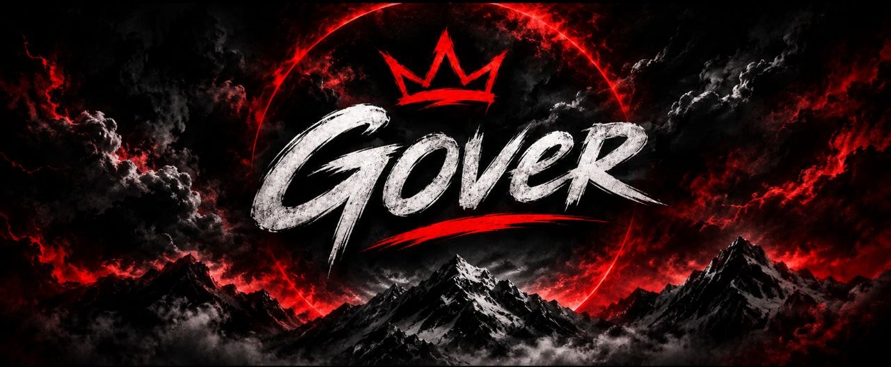

 

### FULL-STACK DEVELOPER · PRODUCT ENGINEER · WEB3 BUILDER

**8 years turning ambitious ideas into working software.**

[English](README.md) · [Русский](ru.md) · [中文](zh.md)

 

---

<h2><em>“I turn ambitious ideas into software people can really use.”</em></h2>

Thoughtful engineering · Clear product thinking · Ready for launch

## About me

Hi, I'm **Gover** — a full-stack developer with around **8 years of experience**. I work across the product: shaping an idea into a plan, choosing an appropriate technical direction, building the frontend and backend, connecting the pieces, and preparing the result for launch.

My focus is practical engineering. I like turning complex requirements into software that is understandable, reliable, and useful. I work with **Rust, Python, Go, JavaScript, Java, and Kotlin**, and I build for the web as well as for automation and Web3 use cases.

## What I build

### Websites and landing pages

Distinctive, responsive web experiences that explain a product clearly and give visitors a confident path forward — from focused landing pages to larger web interfaces.

### Applications and software

Purpose-built applications and software shaped around the job they need to do. I take care of both the user-facing experience and the logic that makes it work.

### Bots and automation

Bots, integrations, and automated workflows that reduce repetitive work and connect the services people already use.

### APIs and backend systems

Server-side logic, APIs, and service integrations designed to keep data and product features working together cleanly.

### Web3 products

Decentralized applications and Web3 product experiences, with the technical choices guided by the product requirements and platform.

### Crypto projects and memecoins

Turnkey development for crypto projects and memecoins — from shaping the concept and technical plan to creating the product experience, supporting website, and launch-ready components.

## How I approach a project

1. **Understand the goal** — clarify the users, essential features, constraints, and definition of done.
2. **Shape the solution** — map the product structure and select technologies that fit the work.
3. **Build end to end** — bring interface, backend, APIs, and integrations together as one coherent product.
4. **Prepare for launch** — refine the details and deliver a solution ready for real use.

The result is more than a collection of code: it is a product with a clear purpose, considered structure, and room to grow.

## What you can expect

- **Clarity before complexity** — decisions tied to the product goal, explained in plain language.
- **One connected perspective** — interface, backend, and integrations considered as parts of the same system.
- **A deliberate build** — focus on what matters now, while keeping the structure understandable and extendable.
- **A launch-minded finish** — details refined so the result is ready to put in front of real users.

## Technology toolkit

I choose a stack to serve the product instead of forcing a product into a stack. My day-to-day toolkit includes **Rust, Python, Go, JavaScript, Java, and Kotlin**, alongside full-stack web development, APIs, automation, and Web3.

## Let's build something worthwhile

Have a product idea, a system to improve, or a process to automate? Tell me what you are trying to achieve, and we can work out the right first step.

