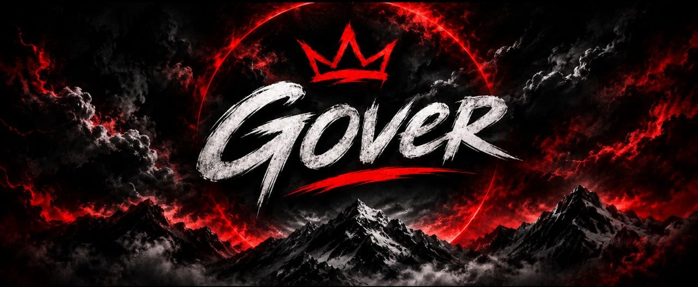

### FULL-STACK РАЗРАБОТЧИК · ИНЖЕНЕР ПРОДУКТОВ · WEB3

**Около 8 лет превращаю амбициозные идеи в работающий код.**

[English](README.md) · **Русский** · [中文](zh.md)

 

---

<h2><em>«Сложные идеи. Чёткая архитектура. Продукт, готовый к запуску.»</em></h2>

Сильная инженерия · Продуктовое мышление · Работающий результат

## Обо мне

Привет, я **Gover** — full-stack разработчик с опытом около **8 лет**. Работаю с продуктом целиком: превращаю идею в план, выбираю техническое направление, создаю frontend и backend, соединяю компоненты и подготавливаю результат к запуску.

Мой подход — практичная инженерия. Мне нравится превращать сложные требования в понятное, надёжное и полезное программное обеспечение. Пишу на **Rust, Python, Go, JavaScript, Java и Kotlin**; создаю решения для веба, автоматизации и Web3.

## Что я создаю

### Сайты и лендинги

Выразительные адаптивные сайты, которые ясно рассказывают о продукте и помогают посетителю сделать следующий шаг: от сфокусированной посадочной страницы до многостраничного веб-интерфейса.

### Приложения и софт

Приложения и программные решения под конкретные задачи. Продумываю пользовательскую часть и логику, которая делает продукт рабочим.

### Боты и автоматизация

Боты, интеграции и автоматизированные процессы, которые убирают повторяющуюся ручную работу и соединяют нужные сервисы.

### API и backend-системы

Серверная логика, API и интеграции между сервисами, чтобы данные и функции продукта работали согласованно.

### Web3-продукты

Децентрализованные приложения и Web3-продукты. Технический подход подбираю под требования продукта и выбранную платформу.

### Криптопроекты и мемкойны

Разработка криптопроектов и мемкойнов под ключ: от проработки идеи и технического плана до создания пользовательской части, сайта и компонентов, необходимых для запуска.

## Как я веду проект

1. **Разбираюсь в задаче** — определяем пользователей, ключевые функции, ограничения и критерии готовности.
2. **Проектирую решение** — формирую структуру продукта и выбираю технологии под задачу.
3. **Собираю продукт целиком** — объединяю интерфейс, backend, API и интеграции в одну систему.
4. **Готовлю к запуску** — довожу детали до порядка и передаю решение, готовое к реальному использованию.

В результате получается не просто набор кода, а продукт с ясной целью, продуманной структурой и возможностью развиваться.

## Что вы получаете в работе

- **Ясность до сложности** — решения связаны с целью продукта и объясняются понятным языком.
- **Взгляд на систему целиком** — интерфейс, backend и интеграции проектируются как части одного решения.
- **Осознанную разработку** — фокус на важном сейчас и понятная структура для дальнейшего развития.
- **Подготовку к запуску** — внимание к деталям, чтобы результат можно было показывать реальным пользователям.

## Технологический арсенал

Подбираю стек под продукт, а не подгоняю продукт под стек. В моём арсенале **Rust, Python, Go, JavaScript, Java и Kotlin**, full-stack веб-разработка, API, автоматизация и Web3.

## Давайте создадим что-то стоящее

Есть идея продукта, система, которую нужно улучшить, или процесс для автоматизации? Напишите, какого результата хотите добиться, — вместе определим хороший первый шаг.

