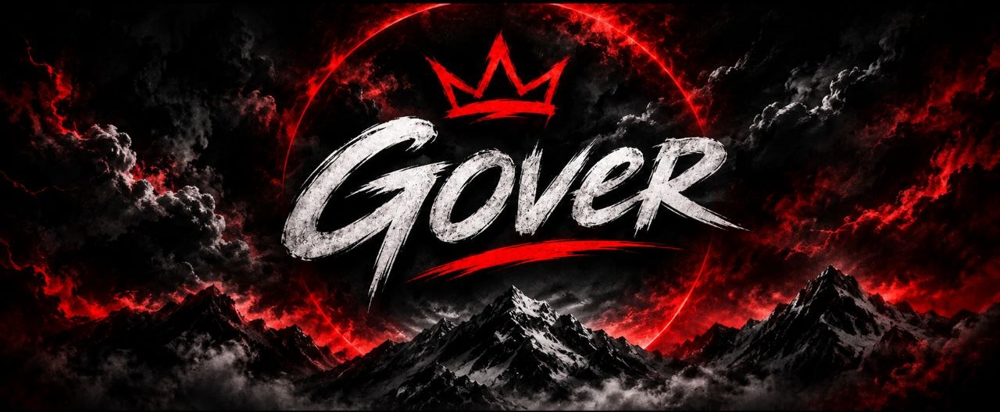

### 全栈开发者 · 产品工程师 · Web3 开发者

**约 8 年经验，将有挑战的想法变成可用的软件。**

[English](README.md) · [Русский](ru.md) · **中文**

 

---

<h2><em>“把复杂想法，变成清晰、可靠、真正可用的产品。”</em></h2>

扎实的工程实践 · 清晰的产品思维 · 面向上线的交付

## 关于我

你好，我是 **Gover**，一名拥有约 **8 年经验**的全栈开发者。我覆盖产品开发的完整流程：梳理想法、确定技术方向、开发前端与后端、连接各个组件，并为上线做好准备。

我专注于务实的工程实践，擅长把复杂需求整理成清晰、可靠、实用的软件。我使用 **Rust、Python、Go、JavaScript、Java 和 Kotlin**，为 Web、自动化和 Web3 场景构建解决方案。

## 我开发什么

### 网站与落地页

打造清晰、有辨识度并适配不同屏幕的网站，让访客快速理解产品并找到下一步。从专注转化的落地页到完整的 Web 界面，都可以按目标设计。

### 应用与软件

围绕实际任务开发应用和软件方案，同时关注面向用户的界面，以及支撑产品运行的内部逻辑。

### 机器人与自动化

通过机器人、服务集成和自动化流程，减少重复操作，让常用工具和服务协同工作。

### API 与后端系统

开发服务端逻辑、API 和系统集成，让数据与产品功能保持清晰、可靠的协作。

### Web3 产品

开发去中心化应用与 Web3 产品体验，并根据产品需求和目标平台确定技术方案。

### 加密项目与 Meme 币

提供加密项目与 Meme 币的端到端开发服务：从构思与技术规划，到用户体验、配套网站及上线所需组件的开发。

## 项目开发方式

1. **理解目标** — 明确用户、核心功能、限制条件和交付标准。
2. **设计方案** — 梳理产品结构，选择适合项目的技术。
3. **端到端开发** — 将界面、后端、API 和集成整合为完整产品。
4. **准备交付** — 完善关键细节，交付可投入实际使用的解决方案。

最终交付的不只是代码，而是目标清晰、结构合理并便于后续发展的产品。

## 合作中你可以期待

- **先明确问题，再增加复杂度** — 每项技术决策都服务于产品目标，并以清晰的方式沟通。
- **完整的系统视角** — 将界面、后端和服务集成作为同一套产品来考虑。
- **有重点的开发过程** — 优先完成当前最重要的部分，同时保持结构清晰、便于扩展。
- **面向上线的交付** — 打磨关键细节，让产品能够面向真实用户使用。

## 技术工具箱

我会根据产品选择技术，而不是让产品迁就技术。常用技术包括 **Rust、Python、Go、JavaScript、Java 和 Kotlin**，以及全栈 Web 开发、API、自动化和 Web3。

## 一起打造有价值的产品

有产品构想、需要改进的系统，或希望自动化的流程？告诉我你想实现什么，我们可以一起确定合适的第一步。

